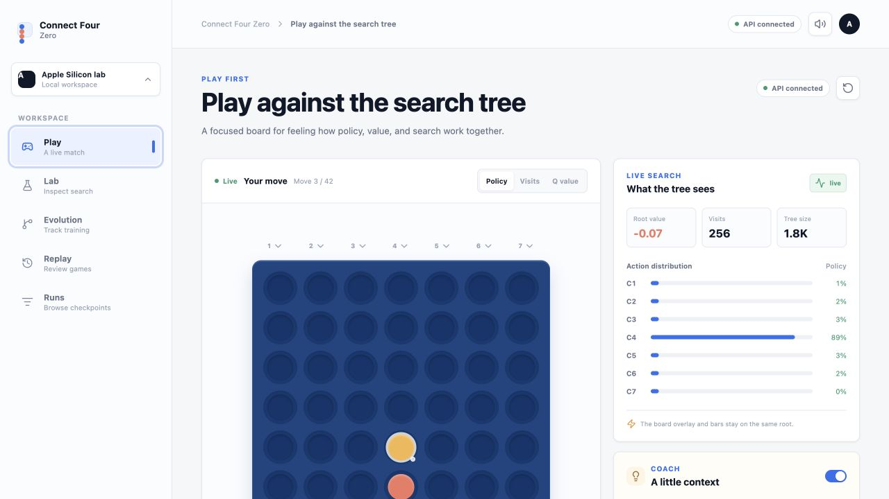
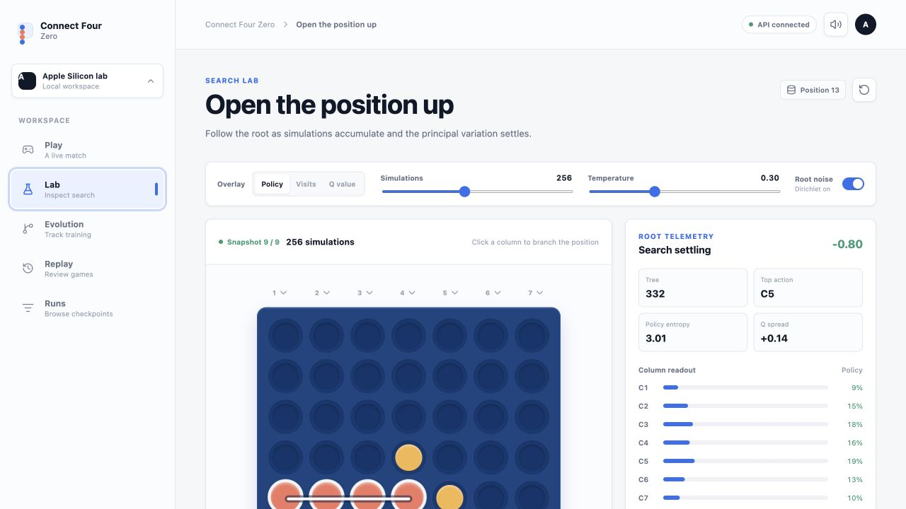
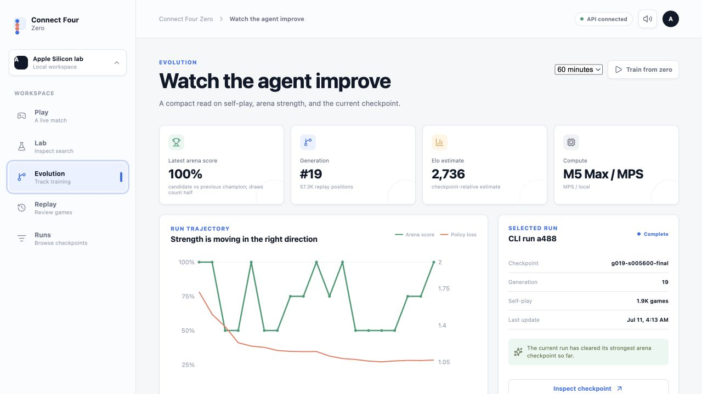
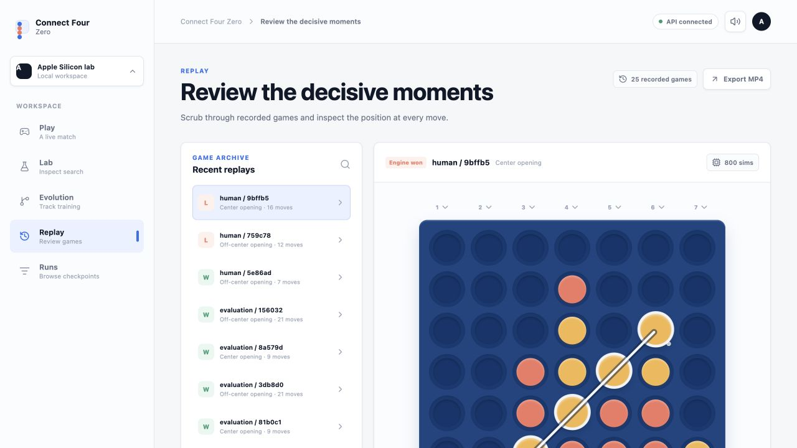
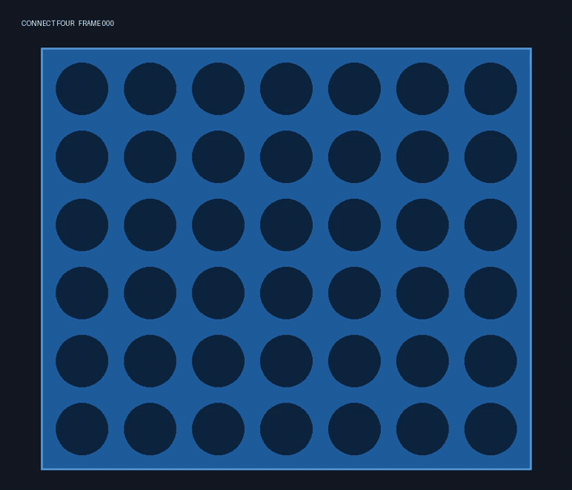
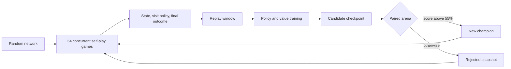

<div align="center">

# Connect Four Zero

**A neural network wakes up knowing nothing about Connect Four. It plays itself, argues with its past selves, and slowly becomes an opponent you can challenge.**

No opening book. No human games. No handcrafted strategy. No perfect solver hiding inside training.

</div>



> **In short:** this repository contains the complete learning loop, a one-hour self-trained checkpoint, a playable neural opponent, a live MCTS microscope, generation history, exact move auditing, and deterministic replay export.

## What Is This?

Connect Four Zero is a small, inspectable AlphaGo Zero-style experiment that runs locally on Apple Silicon.

The model begins with random weights. It generates every lesson by playing against itself, trains on the positions it created, challenges the reigning checkpoint, and promotes a new champion only when the candidate wins the arena. The browser lets you interrupt that loop, inspect what the search tree believes, replay old generations, or sit down across from the resulting model yourself.

The point is not to claim that Connect Four has been solved. It is to make the machinery of self-play tangible. You can watch policy become less diffuse, see MCTS disagree with the raw network, discover where the value head is confidently wrong, and then punish those mistakes in a real game.

## Play In About A Minute

```bash
conda env create -f environment.yml
npm --prefix web install
conda activate connect4-zero
npm --prefix web run build
make start
```

Open [http://127.0.0.1:8000](http://127.0.0.1:8000). You land directly in **Play**.

### How To Play

1. You are red and move first. Click any column to drop a disc.
2. Zero searches the position, shows how its visits evolve, and drops the yellow response.
3. Switch the board overlay between **Policy**, **Visits**, and **Q value**.
4. Choose a checkpoint and search budget:
   - **Beginner:** early checkpoint, 32 simulations
   - **Intermediate:** historical checkpoint, 96 simulations
   - **Hard:** final checkpoint, 256 simulations
   - **Champion:** final checkpoint, 800 simulations
5. Connect four horizontally, vertically, or diagonally. The winning discs lift and a line marks the connection.

The tree is advice, not an oracle. Ignoring its preferred move is allowed. In fact, finding a line it misunderstood is half the fun.

## The Fun Part

- **Play the timeline.** Fight an early checkpoint, then jump to generation 19 and feel what changed.
- **Watch search change its mind.** In Lab, scrub from the first simulation to the settled visit distribution.
- **Interrogate a move.** Compare the network prior, MCTS visits, Q-values, root value, and principal variation.
- **Beat the champion.** It is trained, not solved. Human victories are saved with every search trace.
- **Replay the embarrassment.** Terminal games preserve the connected-four line, solver grade, and move-by-move timeline.
- **Start over from nothing.** Launch a clean 5, 15, 30, or 60-minute experiment and watch a different lineage emerge.

## Four Views Into The Same Mind

| Search Lab | Evolution |
| --- | --- |
|  |  |
| **Open the position up.** Branch any board state and watch the tree settle. | **Watch the lineage.** Loss falls while candidates repeatedly challenge their predecessor. |

| Replay | Export |
| --- | --- |
|  |  |
| **Review decisive moments.** Human, self-play, and arena games share one scrubber. | **Take it with you.** Every replay can become deterministic JSON and MP4. |

## What Happened In One Hour?

The bundled checkpoint came from one real 60-minute run on an Apple M5 Max.

| Measurement | Result |
| --- | ---: |
| Residual network | 64 channels, 6 blocks |
| Trainable parameters | 449,370 |
| Promoted generations | 19 |
| Games recorded | 1,905 total: 1,793 self-play + 112 arena |
| Replay positions | 57,264 |
| Against uniform random at 64 simulations | 200 wins / 200 games |
| Exact tactical probes at 32 simulations | 19 / 24 |
| Exact tactical probes at 800 simulations | 21 / 24 |

That sounds impressive until a human sits down. The first “Champion” lost to casual play. That failure turned out to be one of the most useful results in the project.

### Things The Experiment Made Obvious

**Beating random is a weak milestone.** A 200–0 record looked dramatic and said very little about tactical reliability. The exact solver suite exposed mistakes immediately.

**Search helps, but it cannot repair everything.** Raising MCTS from 32 to 800 simulations improved exact move accuracy from 19/24 to 21/24. The remaining misses come from a policy/value model that still misunderstands some positions.

**“100% arena score” is relative.** It means one candidate beat its previous champion in that promotion cycle. It does not mean 100% against humans, the solver, or every historical strategy.

**A tiny model can still become interesting.** The complete network is smaller than half a million parameters. On the M5 Max, batch-1,024 FP16 reached roughly 106,000 training positions per second and 406,000 inference positions per second in the focused benchmark.

**The visible failure is better than a hidden metric.** Human games are now first-class replays. When the model loses, the useful question is no longer “why is the win rate low?” but “which search trace made the losing move look attractive?”

## How The Learning Loop Works



For each position, PUCT combines the network prior, accumulated Q-value, and an exploration bonus. The target policy is not the network’s first guess; it is the distribution of MCTS visits after search. The value target is simply the eventual outcome from the current player’s perspective.

Training uses no rollout policy and never resigns self-play games.

## What Is Under The Hood?

### Neural network

- Three 6x7 planes: player one, player two, side to move
- 64-channel convolutional stem
- Six residual blocks with batch normalization
- Seven-action policy head
- Scalar `tanh` value head
- Horizontal reflection and color-swap augmentation

### Search and learning

- PUCT Monte Carlo tree search with legal-action masking
- Value sign reversal during backup
- Subtree reuse
- Root Dirichlet noise during self-play
- 100,000-position uniform replay window
- SGD with momentum and budget-relative learning-rate steps
- Batch size 1,024 with MPS FP16 autocast
- Historical champions, rejected candidates, search traces, and representative games retained locally

### Product

- React and TypeScript interface
- FastAPI backend and WebSocket progress stream
- SQLite run storage with atomic PyTorch checkpoints
- Optional private W&B tracking
- Exact bitboard/negamax auditor isolated from training imports
- Deterministic replay JSON and ffmpeg MP4 export

## Train Your Own Lineage

The preset one-hour experiment is:

```bash
make train-60
```

Or launch it from **Evolution → Train from zero**. New runs cannot consume the bundled champion, its games, or its replay buffer.

Production training requires PyTorch MPS. CPU execution is available only for tests and explicit debugging.

Profile the M5 yourself:

```bash
connect4-zero benchmark-mps
```

Challenge any checkpoint with deterministic exact positions:

```bash
connect4-zero audit-accuracy \
  runs/<run-id>/checkpoints/<checkpoint>.pt \
  --positions 24 --simulations 800
```

## Project Map

```text
src/connect4_zero/
  game.py          rules, perspectives, terminal values
  network.py       residual policy/value model and MPS evaluator
  mcts.py          batched PUCT search
  trainer.py       self-play, replay, optimization, arena gating
  auditor/         isolated exact solver
  service.py       human games and training lifecycle
  store.py         SQLite persistence
  export.py        deterministic replay renderer
  api.py           REST and WebSocket interface

web/src/
  App.tsx          Play, Lab, Evolution, Replay, Runs
  components/      board and visual controls
  lib/             API adapter, local demo behavior, sound
```

## Verification

```bash
make test
npm --prefix web run build
```

Tests cover game legality, gravity, wins, draws, perspective changes, symmetry augmentation, bitboard equivalence, PUCT selection and backup, checkpoint gating, persistence, MPS forward/backward execution, API behavior, replay export, and the solver import boundary.

## Experiment Tracking

SQLite databases and `.pt` checkpoints are the source of truth. W&B is optional and failures never stop local training.

```bash
wandb login
export WANDB_PROJECT=connect-four-zero
make train-60
```

Runs, checkpoints, exports, credentials, W&B state, environments, and frontend build output are excluded from Git.

## Can It Be Deployed?

Yes, with one important distinction.

The React application can be hosted statically as a visual showcase. It can display the bundled timeline and replays, but a static host cannot execute the PyTorch checkpoint.

Real neural play needs the FastAPI service because every move runs MCTS backed by the policy/value network:

```text
Browser  →  FastAPI inference service  →  policy/value checkpoint
                           |
                           +→ read-only replay and run data
```

Training should stay on the Apple Silicon machine. A public service should expose rate-limited human play and read-only experiment data, while keeping run creation and training controls private.

That split gives visitors the real model without handing the internet a button that starts an unlimited training job.
